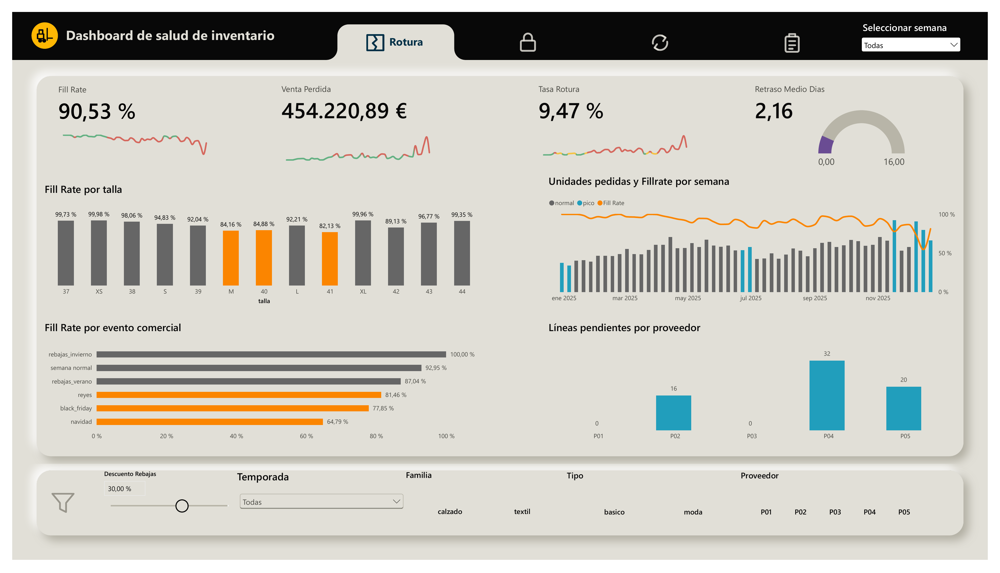
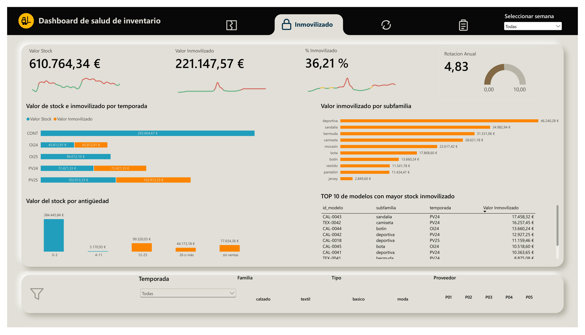
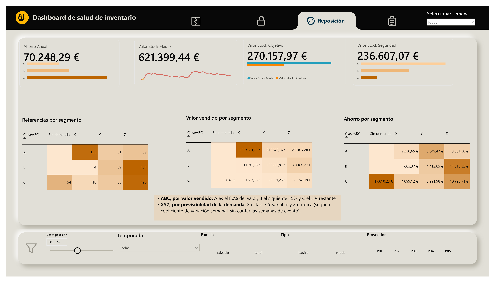
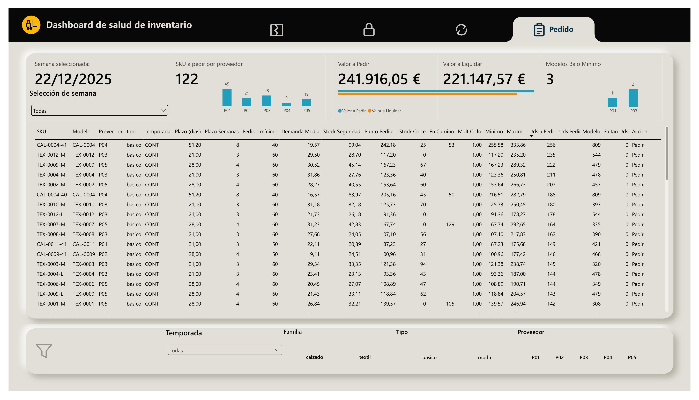

# Hallazgos por página

Detalle de lo que muestra cada página del dashboard, con las cifras que lo sostienen y la lectura de cada una. El resumen está en el [README](../README.md) y la construcción del modelo en [modelo_y_dax.md](modelo_y_dax.md).

**Pregunta de fondo:** ¿cómo reducir a la vez las roturas de stock y el capital inmovilizado del almacén central, y con qué política de reposición?

---

## Página 1. ¿Dónde se rompe el stock?



**Cifras de cabecera.** Fill rate (nivel de servicio) del 90,53%, tasa de rotura del 9,47%, venta perdida de 454.221 € con el descuento de rebajas por defecto (30%) y retraso medio de 2,16 días en la recepción de pedidos.

### 1.1. Las tallas centrales se rompen y las extremas sobran

| Tallas | Fill rate |
|---|---|
| Centrales (40 y 41 en calzado, M en textil) | 83,77% |
| Extremas | 94,74% |

Once puntos de diferencia. Las tres tallas centrales quedan entre el 82% y el 85%, mientras que las extremas están por encima del 89%. La compra reparte las tallas de forma más plana que la demanda real: lo que más se pide es lo que antes se agota.

### 1.2. Los picos de demanda rompen el servicio

| Tipo de semana | Fill rate |
|---|---|
| Normal | 92,95% |
| Pico | 79,06% |

Catorce puntos menos en las 8 semanas de pico. Por evento comercial:

| Evento | Fill rate |
|---|---|
| Navidad | 64,79% |
| Black Friday | 77,85% |
| Reyes | 81,46% |
| Rebajas de verano | 87,04% |
| Rebajas de invierno | 100,00% |

Navidad es el peor momento del año. Las rebajas de invierno se sirven al 100% porque el pico recae sobre restos de temporada con stock de sobra, no sobre producto de reposición.

### 1.3. P04 rompe 2,6 veces más que el resto

| Indicador | P04 | Resto de proveedores |
|---|---|---|
| Tasa de rotura | 20,90% | 8,07% |
| Fill rate | 79,10% | Entre 89,75% y 93,13% |
| Retraso medio de lo recibido | 16,2 días | 2,16 días (media de todos) |
| Unidades recibidas sobre pedidas | 86,6% | |
| Líneas de compra pendientes al cierre | 32 | P05: 20, P02: 16, P01 y P03: 0 |

P04 declara un plazo de 35 días, pero el plazo medio observado en sus pedidos recibidos es de 51,2. Concentra 32 de las 68 líneas pendientes al cierre. El retraso medio de 16,2 días **subestima** el problema: los pedidos más retrasados siguen sin recibir y no entran en la media, por eso se lee junto a las líneas pendientes.

### 1.4. La tienda no explica las roturas

Comprobado con una segmentación temporal por tienda: el fill rate de las seis tiendas está entre el 90,32% y el 90,72%. El problema no está en la demanda de una tienda concreta sino en el almacén y la política de compra.

---

## Página 2. ¿Cuánto capital está parado?



**Cifras de cabecera.** Valor del stock al cierre (22/12/2025) de 610.764 €, de los cuales 221.148 € (36,21%) llevan 12 semanas o más sin ninguna salida. La rotación anual es de 4,83 veces.

### 2.1. Qué está parado

El stock inmovilizado es el de las referencias sin ninguna unidad servida en las últimas 12 semanas. Por antigüedad del stock al cierre:

| Semanas desde la última salida | Valor del stock |
|---|---|
| 0 a 3 | 384.446 € |
| 4 a 11 | 5.171 € |
| 12 a 25 | 99.320 € |
| 26 o más | 44.173 € |
| Sin ninguna venta | 77.654 € |

Los tres últimos tramos suman los 221.148 € inmovilizados. Casi dos tercios del stock (63%) ha tenido salida en las últimas 3 semanas; el 36% lleva 12 semanas o más sin salir.

### 2.2. Por temporada

| Temporada | Valor del stock | Inmovilizado |
|---|---|---|
| CONT (básicos) | 293.605 € | 0 € |
| OI25 | 96.012 € | 0 € |
| PV25 | 102.913 € | 102.913 € |
| PV24 | 72.421 € | 72.421 € |
| OI24 | 45.813 € | 45.813 € |

Todo lo que queda de PV24, OI24 y PV25 está parado; los básicos y la temporada en curso (OI25) no tienen nada inmovilizado. Casi la mitad del capital parado (47%) es producto de PV25 que no se vendió esa temporada.

### 2.3. Dónde está el dinero

| Subfamilia | Valor inmovilizado |
|---|---|
| Deportiva | 46.240 € |
| Sandalia | 34.983 € |
| Bermuda | 31.331 € |
| Camiseta | 28.621 € |
| Mocasín | 22.617 € |
| Otras cinco (bota, botín, vestido, pantalón y jersey) | 57.355 € |

Las tres primeras subfamilias concentran el 51% del capital parado. Los 10 modelos con más stock inmovilizado suman 118.427 €, el 54% del total, y el primero es la sandalia CAL-0043 de PV24 con 17.458 €. Son los candidatos concretos a liquidar o trasladar.

### 2.4. Básicos y moda rotan a ritmos muy distintos

| | Rotación anual |
|---|---|
| Calzado básico | 9,6 |
| Textil básico | 9,3 |
| Calzado moda | 2,2 |
| Textil moda | 2,1 |

El almacén tuvo de media 621.399 € en stock y sirvió 3.001.969 € a coste. Los básicos se renuevan más de 9 veces al año; la moda, apenas 2.

---

## Página 3. ¿Qué política de reposición corresponde?

La política fija para cada referencia (cada talla de cada modelo) **cuánto stock de colchón tener y en qué momento pedir**. Los apartados 3.1 a 3.5 explican cómo se calcula, en cuatro pasos: medir la demanda, clasificar el surtido, calcular el stock de seguridad y, con él, el punto de pedido. A partir de la captura, los apartados 3.6 a 3.9 recorren lo que muestra la página: dónde están las referencias, dónde está el valor y de dónde sale el ahorro.

### Cómo se calcula la política

Las fórmulas siguen la teoría estándar de gestión de inventarios (Chopra y Meindl; Silver, Pyke y Thomas). Las referencias completas están en [modelo_y_dax.md](modelo_y_dax.md#6-referencias).

#### 3.1. Paso 1: la demanda de cada referencia

Para cada referencia se toman sus semanas de venta (de la primera a la última semana con pedidos de tienda), se quitan las semanas de evento y se calculan dos datos:

- **Demanda media:** unidades pedidas por semana, sumando las seis tiendas.
- **Variabilidad:** cuánto se aleja cada semana de esa media (la varianza).

Las semanas de evento se dejan fuera porque con un solo año de datos no se puede estimar un patrón estacional. Los picos se tratan aparte, con multiplicadores fijos, en la página 4.

#### 3.2. Paso 2: clasificar el surtido (ABC/XYZ)

**ABC, por valor vendido.** Se ordenan las referencias de más a menos valor vendido y se va acumulando:

| Clase | Qué recoge |
|---|---|
| A | Las que suman el primer 80% del valor vendido |
| B | El siguiente 15% |
| C | El 5% restante |

**XYZ, por previsibilidad.** Se mide con el coeficiente de variación, que compara lo que oscila la demanda con su tamaño:

```text
Coeficiente de variación = desviación típica semanal / demanda media semanal
```

*(Scholz-Reiter et al., 2012)*

| Clase | Coeficiente de variación | Demanda |
|---|---|---|
| X | Menor de 0,5 | Estable |
| Y | De 0,5 a 1 | Variable |
| Z | Mayor de 1 | Errática |

Las referencias que no tienen demanda en semanas normales quedan aparte, en la clase «Sin demanda».

#### 3.3. Paso 3: el stock de seguridad

Es el colchón que cubre los imprevistos mientras se espera un pedido. Hay dos riesgos: que la demanda sea mayor de lo normal durante el plazo de entrega y que el pedido tarde más de lo previsto. La fórmula suma los dos:

```text
Stock de seguridad = z × √( plazo × varianza de la demanda + demanda media² × desviación del plazo² )
```

*(Chopra y Meindl, caso de plazo variable)*

- El **plazo** y su **desviación** van en semanas. Se usa el declarado por cada proveedor, salvo en P04, que usa el plazo observado (51,2 días frente a 35 declarados) con la desviación declarada de 20 días.
- **z** depende del nivel de servicio que se quiere dar a cada clase. Cuanto más alto, más colchón:

| Clase | Nivel de servicio | z |
|---|---|---|
| A | 95% | 1,65 |
| B | 90% | 1,28 |
| C | 85% | 1,04 |

Un nivel de servicio del 95% significa que en 95 de cada 100 ciclos de pedido no debería faltar stock antes de que llegue la mercancía. Las referencias A, las que más valor venden, reciben el colchón más alto.

#### 3.4. Paso 4: el punto de pedido

Es el nivel de stock al que hay que lanzar un pedido:

```text
Punto de pedido = demanda media × plazo + stock de seguridad
```

*(Chopra y Meindl)*

Cuando el stock más lo que viene en camino baja de este nivel, se pide. Lo que queda cubre la demanda normal hasta que llega el pedido y el stock de seguridad cubre los imprevistos. En la página 4 este punto de pedido se convierte en el **mínimo**, con una diferencia: usa la demanda prevista semana a semana, con los picos, en lugar de la media.

#### 3.5. La política por clase

| Clase | Nivel de servicio | Stock de seguridad por referencia (media) | Punto de pedido por referencia (media) | Valor del stock de seguridad |
|---|---|---|---|---|
| A | 95% | 25,4 uds | 71,2 uds | 134.804 € |
| B | 90% | 18,8 uds | 42,7 uds | 76.323 € |
| C | 85% | 8,1 uds | 20,8 uds | 25.481 € |

El stock de seguridad de todas las referencias vale 236.607 €. Es el colchón que necesita cada una **mientras se vende**. Un producto de temporada solo lo necesita unas semanas al año, por eso esta cifra no se resta tal cual del stock actual: en el ahorro (3.8) se pondera por las semanas de venta de cada referencia.

### Qué muestra la página



#### 3.6. Dónde están las referencias

| Clase ABC | Referencias | De las cuales Z (errática) |
|---|---|---|
| A | 193 | 39 |
| B | 174 | 131 |
| C | 231 | 126 |

Las dos celdas mayores de demanda errática son BZ (131 referencias) y CZ (126), todas de moda. La celda AX, con 123 referencias, son los básicos estables y de mayor valor. Otras 54 referencias, también de moda, apenas venden (clase «Sin demanda»).

#### 3.7. Dónde está el valor

Las 123 referencias AX venden 1.953.622 €, el 65% del valor vendido en el año (3.001.969 €) y más que todos los demás segmentos juntos. La celda más grande de demanda errática, BZ, vende 334.091 € con 131 referencias: AX vende casi seis veces más con menos referencias. El valor está en pocos básicos estables, no en la moda.

#### 3.8. El ahorro anual

El ahorro compara el stock medio que hubo en 2025 con el que habría con esta política (el stock objetivo). Primero se calcula el stock objetivo de cada referencia:

```text
Stock objetivo medio = ( stock de seguridad + pedido de 4 semanas / 2 ) × semanas de venta / 52
```

*(Chopra y Meindl: stock medio = medio pedido + stock de seguridad; la ponderación por semanas de venta es decisión del proyecto)*

- Entre dos pedidos el stock baja desde «colchón + pedido recién llegado» hasta «solo el colchón». De media queda en el colchón más **medio pedido**. Cada pedido cubre 4 semanas de demanda.
- Se multiplica por **semanas de venta / 52** porque un producto que se vende 20 semanas solo necesita stock esas 20 semanas.
- Las referencias sin demanda tienen stock objetivo 0.

Después se aplica el coste de mantener stock (capital inmovilizado, almacenaje, obsolescencia), que se estima en el 20% de su valor al año. El 20% es una hipótesis ajustable, no un dato.

```text
Ahorro anual = ( stock medio actual - stock objetivo medio ) × 20%
```

| Paso | Valor |
|---|---|
| Stock medio actual (media de los cierres semanales de 2025) | 621.399 € |
| Stock medio con la política propuesta (stock objetivo) | 270.158 € |
| Diferencia: capital que dejaría de estar inmovilizado | 351.241 € |
| **Ahorro anual** (diferencia por 20%) | **70.248 €** |

Es un neto: 499 referencias tienen stock de sobra (413.081 €) y 99 se quedan por debajo del objetivo (61.840 €). No incluye la venta perdida y no es una simulación.

#### 3.9. El ahorro no está donde se vende

| Segmento | Ahorro anual | Peso en el total |
|---|---|---|
| Sin demanda (54 referencias, C) | 17.610 € | 25% |
| BZ | 14.318 € | 20% |
| CZ | 10.721 € | 15% |
| AY | 8.649 € | 12% |
| AX | 2.239 € | 3% |

AX, el segmento que más vende, aporta solo 2.239 €, porque su stock ya está cerca del objetivo. El ahorro sale sobre todo de la moda errática y de las 54 referencias sin demanda, cuyo stock objetivo es cero y cuyo stock medio actual es de 88.051 €.

---

## Página 4. ¿Qué hay que pedir y qué liquidar?



Esta página aplica la política de la página 3 a una semana concreta y responde a lo encontrado en las dos primeras. El mínimo es el punto de pedido de la página 3 (demanda durante el plazo más stock de seguridad según la clase ABC), pero con la demanda prevista semana a semana en lugar de la media, de modo que incluye los picos que rompían el servicio (1.2). Se calcula por talla, así que las tallas centrales, las que más se rompen, reciben más stock que las extremas (1.1), y P04 se pide con su plazo real de 51,2 días (1.3). La lista de liquidar es el stock parado de la página 2: referencias con 12 semanas o más sin salidas.

Es una recomendación calculada con el estado real de la semana elegida (semana de corte): stock de cierre, pedidos en camino y previsión de demanda con los eventos que entran en el ciclo. Usa un sistema de mínimo y máximo por referencia: si el stock más lo que viene en camino está en el mínimo o por debajo, se pide hasta el máximo.

### 4.1. La última semana (22/12/2025)

| Acción | Referencias | Valor |
|---|---|---|
| Pedir | 122 (10.589 unidades) | 241.916 € |
| Liquidar | 225 | 221.148 € |
| Sin acción | 251 | |
| Total | 598 | |

Además, 3 modelos tienen un pedido que no llega al mínimo del proveedor (1 de P01 y 2 de P03).

### 4.2. Por proveedor

| Proveedor | A pedir (referencias) | Valor a pedir | Valor a liquidar |
|---|---|---|---|
| P01 | 45 | 75.294 € | 44.484 € |
| P02 | 21 | 49.733 € | 49.086 € |
| P03 | 28 | 46.864 € | 43.230 € |
| P04 | 9 | 36.450 € | 41.800 € |
| P05 | 19 | 33.576 € | 42.548 € |

P04 solo tiene 9 referencias a pedir, pero suman 36.450 € (4.050 € por referencia, frente a 1.673 € en P01), en línea con su plazo de 8 semanas.

### 4.3. Lo que cambia con la semana

La recomendación no es una cifra fija: depende del estado de cada semana.

| Semana de corte | Referencias a pedir | Valor a pedir | Referencias a liquidar |
|---|---|---|---|
| 24/03/2025 | 35 | 74.726 € | 48 |
| 23/06/2025 | 45 | 110.979 € | 78 |
| 25/08/2025 | 66 | 153.502 € | 80 |
| 20/10/2025 | 101 | 249.071 € | 225 |
| 24/11/2025 | 167 | 403.909 € | 225 |
| 22/12/2025 | 122 | 241.916 € | 225 |

Al llegar el 20/10 el pico de Navidad ya entra en el ciclo de los pedidos: el multiplicador medio del ciclo va de ×1,05 en P04 a ×1,30 en P01. En la última semana el multiplicador es 1,00 porque el calendario de eventos acaba el 28/12/2025 y no ve los picos de enero.

### 4.4. Lo que ya viene en camino no se vuelve a pedir

Con el corte del 20/10, sin descontar las unidades en camino saldrían 160 referencias y 463.887 €; descontándolas, 101 y 249.071 €. Es parte del estado real de la semana: evita pedir dos veces lo que ya viene.

### 4.5. Cómo leer una fila

La primera fila de la tabla de la captura es la referencia CAL-0004-41 (básico, P04):

| Campo | Valor |
|---|---|
| Plazo de entrega | 51,2 días (8 semanas) |
| Stock al corte + en camino | 25 + 53 = 78 uds |
| Mínimo / máximo | 255,58 / 333,86 uds |
| Unidades a pedir | 333,86 - 78 = 255,86, redondeado a 256 uds |

El stock más lo que viene (78) está por debajo del mínimo, así que se pide hasta el máximo. El modelo CAL-0004 suma 809 unidades de pedido entre todas sus tallas, por encima del mínimo del proveedor (40), por lo que no hay aviso.

### 4.6. Coherencia con la página 2

Las 225 referencias a liquidar valen 221.148 €, la misma cifra que el stock inmovilizado de la página 2 al cierre. Entre el 07/07 y el 25/08 las dos difieren: la página 2 cuenta como parado el stock de la temporada nueva (OI25) todavía sin vender, y la recomendación cuenta la antigüedad desde el inicio de temporada.

---

## Decisiones de método

Cuatro decisiones condicionan las cifras de arriba y conviene tenerlas presentes.

- **Plazo de P04: el observado, con la desviación declarada.** Para el cálculo del stock de seguridad y del punto de pedido se usa el plazo medio observado de P04 (51,2 días frente a los 35 declarados) con la desviación declarada (20 días; la observada, 12,6, es menor porque los pedidos más retrasados siguen pendientes). Es la combinación más prudente y la que da el ahorro de 70.248 €. Para el resto de proveedores se usa el plazo declarado.
- **Semanas de evento fuera de la demanda base.** La clasificación XYZ y el stock de seguridad se calculan sin las semanas de pico. Con un solo año de datos no se puede estimar un índice estacional, así que los picos se tratan aparte con multiplicadores fijos.
- **Stock objetivo ponderado por la ventana de venta.** Un producto de temporada solo necesita stock mientras se vende. Sin esta ponderación, el objetivo de la moda se sobrestima y el ahorro sale mucho menor.
- **El pedido mínimo del proveedor es por modelo, no por línea.** Los 424 pedidos reales por modelo y fecha superan el mínimo del proveedor, mientras que 1.065 de las 2.756 líneas de compra tienen menos de 40 unidades. Por eso la medida avisa por modelo y no bloquea ni completa el pedido.

La página 4 es una decisión de un momento, no una simulación del año: no hay cifra anual de ahorro ni de nivel de servicio para la recomendación.
